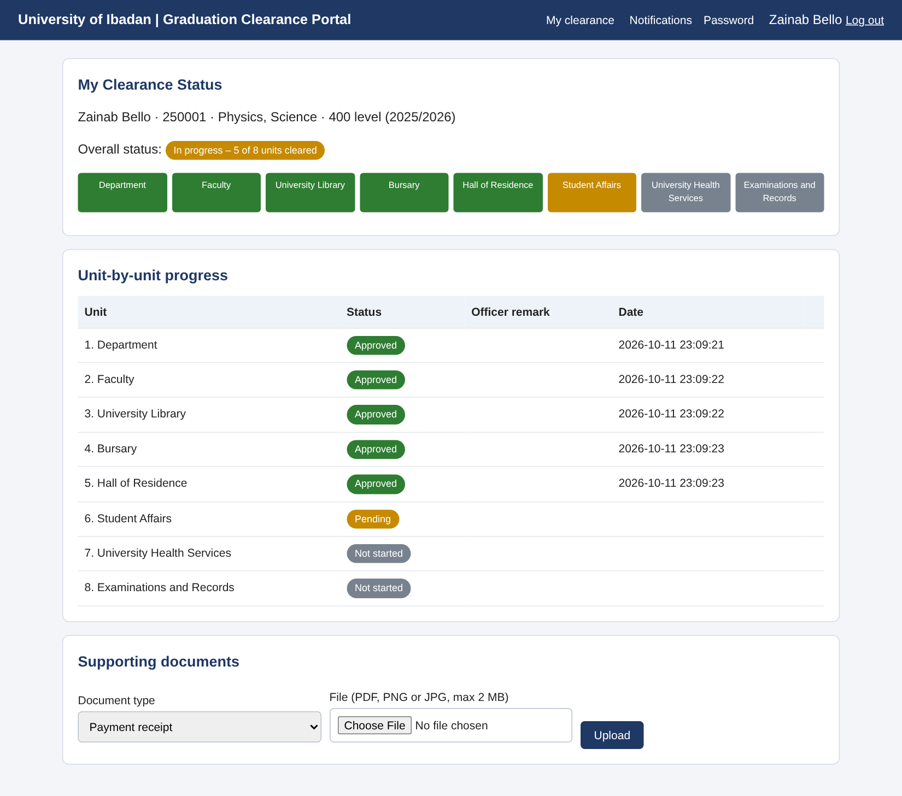
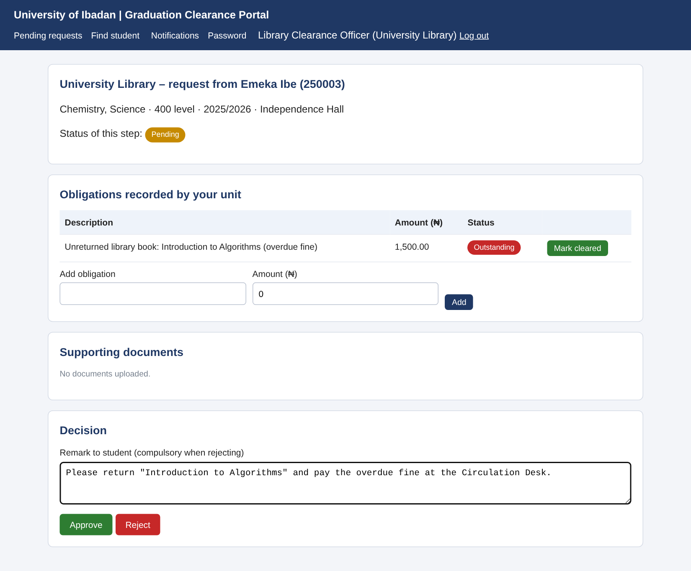

# Automated Online Graduation Clearance System
### Case study: University of Ibadan

**CSC 476 semester project**, Department of Computer Science, Faculty of Science, University of Ibadan.
**Project supervisor and Head of Department:** Prof. Bolanle Oladejo

A web application that replaces the paper graduation-clearance form. A final-year student applies online, the request
is routed automatically through the eight clearance units in order, each officer approves or rejects with a recorded
reason, the student is notified at every step, and the last approval issues a clearance certificate with a QR code
that anyone can verify online.

| Student dashboard | Officer review page |
|---|---|
|  |  |

## Project team and roles

Roles are assigned under the direction of the group leader, **Opeyemi Ogunniyi**.

| Member | Matric no. | Role | Responsibility |
|---|---|---|---|
| Opeyemi Ogunniyi | E051333 | **Group leader**, Project Manager and Integration Lead | Plans the work, assigns tasks, reviews and merges contributions, final integration and submission |
| Taiwo Jesujoba | E052302 | Backend Developer | Workflow engine (`clearance/workflow.py`), authentication and access control |
| Rasheedat Abdulrasheed | E051344 | Database Designer | Schema (`clearance/schema.sql`), data model, seed data, reports queries |
| Oyindamola Omole | E051350 | UI/UX and Front-end Developer | Templates and stylesheet, responsive layout, accessibility |
| Omoloye Felix Olamide | E048840 | Quality Assurance and Security Tester | Automated tests (`tests/`), security testing, bug reports |
| Favour Kadana | E051336 | Documentation and Literature Lead | Project report, proposal, literature review and reference folder |

## Features

* **Student:** eligibility check, one-click application, live status of all eight units, officer remarks, upload of supporting documents (PDF/PNG/JPG, 2 MB), resubmission after a rejection, certificate download.
* **Clearance officer (per unit):** queue of requests that have reached the unit, student record, obligations, approve/reject (a reason is compulsory when rejecting), record and clear obligations.
* **Records officer:** final unit; approval issues the certificate; list of cleared students.
* **Administrator:** create/deactivate users, change the units and their order without code changes, reports (progress and average processing time per unit, CSV export), audit log.
* **Public:** certificate verification page (`/verify`), reached by the QR code on the certificate.
* **Notifications:** in-app, e-mail (SMTP, when configured) and SMS (gateway interface; *simulated* in this prototype).

Default clearance order (editable by the administrator): Department, Faculty, University Library, Bursary,
Hall of Residence, Student Affairs, University Health Services, Examinations and Records.

## Technology

Python 3.10+, Flask 3, Jinja2, SQLite (standard SQL, portable to MySQL), ReportLab (PDF certificate and QR code), plain HTML/CSS (no JavaScript needed), `unittest` for tests.

## Run it locally

```bash
pip install -r requirements.txt

export FLASK_APP=wsgi.py            # Windows PowerShell:  $env:FLASK_APP="wsgi.py"
flask init-db                       # create the tables
flask seed-demo                     # 8 units, staff accounts and 30 fictional students
flask run                           # open http://127.0.0.1:5000
```

### Demo logins (password for every demo account: `Demo@1234`)

| Role | Username |
|---|---|
| Student (final year) | `250001` ... `250028` (`250029` and `250030` are 300-level, so they are *not* eligible) |
| Officers | `staff.dept`, `staff.faculty`, `staff.library`, `staff.bursary`, `staff.hall`, `staff.affairs`, `staff.health` |
| Records officer | `staff.records` |
| Administrator | `admin` |

Student `250003` has an outstanding library obligation and `250005` an outstanding bursary levy, so you can see rejection and resubmission.
All names, IDs, e-mail addresses and phone numbers are invented. **Change the demo password and set `SECRET_KEY` and `CERT_KEY` before any real use.**

### Configuration (environment variables)

| Variable | Purpose |
|---|---|
| `SECRET_KEY` | Signs session cookies (required in production) |
| `CERT_KEY` | Secret used to sign certificate numbers (required in production) |
| `BASE_URL` | Public address of the site, written into the certificate QR code |
| `COOKIE_SECURE=1` | Send cookies over HTTPS only (set when deployed behind HTTPS) |
| `SMTP_HOST`, `SMTP_PORT`, `SMTP_USER`, `SMTP_PASSWORD`, `MAIL_FROM` | Real e-mail delivery (otherwise e-mails are recorded as *simulated*) |

## Tests

```bash
python -m unittest discover -s tests -t . -v
```

32 automated tests cover login and lock-out, eligibility, routing, approval and rejection rules, resubmission,
upload validation, changing the unit order, certificate issue and verification, simultaneous decisions on the same request,
notifications, reports, role-based access control, SQL injection, stored XSS, CSRF, session invalidation and timeout,
unrestricted file upload, open redirects and security headers. Test names carry the IDs used in the project report.

## Security design (summary)

* Passwords hashed with scrypt (Werkzeug); account locked for 15 minutes after 5 failed logins; generic login error (no user enumeration).
* Role-based access control on every route; officers can only act on their own unit's requests.
* Parameterised SQL everywhere; Jinja auto-escaping; CSRF token on every POST; strict Content-Security-Policy and other security headers.
* Sessions: HttpOnly, SameSite cookies, 30-minute inactivity timeout, and a per-user session nonce so a copied cookie stops working after logout or password change.
* Uploads: extension allow-list, file-signature check, 2 MB limit, random stored names, kept outside the static folder and served only to authorised users.
* Certificates: number = `UI/CLR/<year>/<request id>-<HMAC>`; the verify page checks the HMAC *and* the database.
* Audit log of logins, decisions, obligations and administrative actions.

## Layout

```
clearance/            application package
  __init__.py         app factory, security headers, CLI commands
  schema.sql          database schema
  workflow.py         clearance rules: eligibility, routing, decisions, resubmission
  certificate.py      certificate number, QR code, PDF
  auth.py, student.py, officer.py, admin.py, public.py   routes (blueprints)
  notify.py           in-app / e-mail / SMS notifications
  seed.py             demo data
  templates/, static/ pages and stylesheet
tests/                automated tests
docs/                 screenshots and a sample certificate
wsgi.py               entry point
```

## Known limitations

* SMS delivery is a stub (messages are recorded as *simulated*); e-mail needs SMTP settings.
* Not yet integrated with the University's existing portals; obligations are recorded by the units.
* The clearance units and their order reflect the commonly followed process and must be confirmed against official University policy.
* Tested on SQLite; the schema uses standard SQL, but moving to MySQL would need a driver, a new connection in `clearance/db.py` and a few dialect changes (for example `BEGIN IMMEDIATE` and `julianday` in the queries).
* Security tests were run by the development team, not by an independent auditor.

## Licence and academic use

Prepared for CSC 476 at the University of Ibadan. Demo data are fictional.
